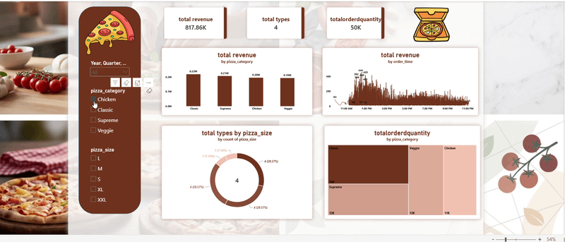

# 🍕 Pizza Sales Analytics Dashboard (Power BI)

An end-to-end Business Intelligence project built using **Power BI** to analyze pizza sales performance, revenue trends, product popularity, and order volumes.

---

## 🎬 Interactive Dashboard Preview

---

## 📊 Key Performance Indicators (KPIs) & Business Insights
- **Total Revenue & Orders:** Tracked total revenue generated across various pizza categories and monitored total sales volume.
- **Category & Size Performance:** Identified top-performing product categories (Chicken, Classic, Supreme, Veggie) and preferred pizza sizes.
- **Time-Series Analysis:** Visualized peak ordering hours and daily sales distribution to understand customer behavior.

---

## 🛠️ Tools & Technologies Used
- **Data Visualization:** Power BI Desktop
- **Data Modeling & Transformation:** Power Query, DAX (Data Analysis Expressions)
- **Version Control:** Git & GitHub

---

## 📁 Repository Structure
- `Pizza Sales Analytics Dashboard.pbix`: The complete Power BI source file containing data models, calculated measures, and interactive layouts. You can download and explore it locally!
